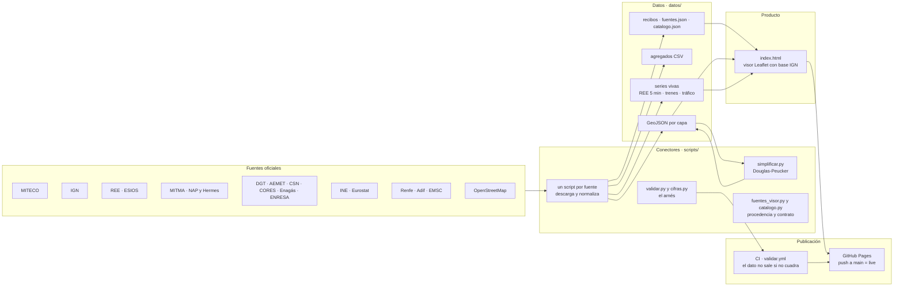
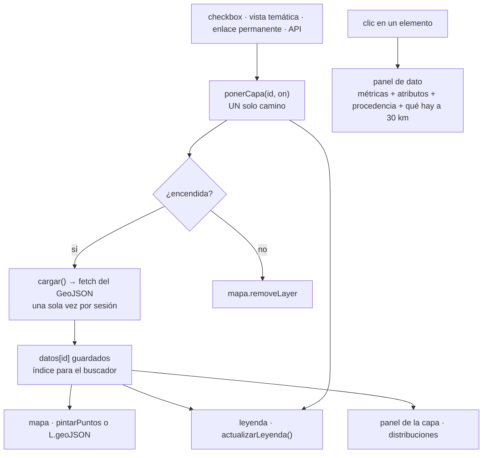

# OpenInfraES — infraestructura de España, en datos

**Visor en vivo:** <https://ntizar.github.io/OpenInfraES/> (GitHub Pages, sin clave ni registro)

Una base de datos de la infraestructura española y el mapa para mirarla. **No es un visor con datos
dentro: es el dato ordenado para poder volver a usarlo**, y el mapa es su índice. Cada capa declara
de qué organismo sale, de cuándo es y qué licencia tiene; cada elemento abre una ficha con sus
atributos, sus números clave, su procedencia y **qué otros datos hay a menos de 30 km**.

> Hecho con ❤️ por David Antizar · datos © colaboradores de OpenStreetMap (ODbL) y de los organismos citados

## Cómo está montado



**Lo que se entiende al mirarlo:** ningún dato entra a mano. Se descarga con un script, se normaliza,
se simplifica si pesa, se le escribe su recibo y su ficha en el catálogo, y el visor lo pinta por
`fetch`. El validador y el contador de cifras son las dos puertas: si un recibo no cuadra o una tabla
de este README se desfasa de la realidad, el CI se pone rojo.

### Cómo se enciende una capa (el mecanismo que se malinterpreta)



Las cuatro puertas que encienden una capa llaman a la misma función. Cuando cada una tocaba el
checkbox por su cuenta, la leyenda se quedaba abierta sobre una capa ya apagada.

## Documentación

| Documento | Qué encontrarás |
|---|---|
| [`docs/PROYECTO.md`](docs/PROYECTO.md) | qué es, qué contiene, rendimiento medido y límites |
| [`docs/BIBLIOTECA.md`](docs/BIBLIOTECA.md) | **para qué existe esto**: base reutilizable y cómo crece con fichas enriquecidas |
| [`docs/FUENTES.md`](docs/FUENTES.md) | **ficha por organismo**: qué publica, URL, cómo se obtiene, licencia, frecuencia y límites |
| [`docs/apis.md`](docs/apis.md) | estado técnico de cada API, con los errores literales |
| [`docs/PATRON-MCP.md`](docs/PATRON-MCP.md) | convertir un recurso oficial en servidor MCP, con el estudio medido de `ree-mcp` |
| [`docs/MCP-FEDERADO.md`](docs/MCP-FEDERADO.md) | **las 77 capas como un solo MCP**: estudio medido de CivicMesh OS, contrato de respuesta y las 12 herramientas publicadas |
| [`docs/AUDITORIA.md`](docs/AUDITORIA.md) | auditorías del proyecto: qué fallaba, qué se corrigió y cómo se verificó |
| [`docs/emplazamiento.md`](docs/emplazamiento.md) | **consultar un punto**: el contexto que da el dato abierto y lo que falta, con el probador y sus huecos |
| [`GUIA.md`](GUIA.md) | reglas de trabajo: cómo añadir una capa, sin editar a mano, sin inventar |
| `docs/aemet.md` · `docs/dgt.md` · `docs/gtfsrt.md` · `docs/nap.md` | el detalle de cada fuente difícil |
| `docs/ine.md` · `docs/irewater.md` · `docs/precio.md` · `docs/produccion.md` | demografía, agua, mercado y generación |
| `docs/normalizacion.md` · `docs/wms.md` | provincias por código oficial y por qué el ráster va por WMTS |

## Capas del visor

**79 capas en 15 grupos temáticos**, con carga bajo demanda: nada se descarga hasta que lo enciendes.

<!-- CIFRAS-GRUPOS:INICIO (lo reescribe scripts/cifras.py) -->
| Grupo | Capas | Objetos |
|---|---:|---:|
| **Red eléctrica** | 4 | 5.593 |
| **Generación** | 8 | 8.530 |
| **Gas** | 6 | 843 |
| **Agua** | 14 | 17.330 |
| **Demografía** | 5 | 8.199 |
| **Transporte** | 20 | 33.502 |
| **DGT · Tráfico** | 4 | 15.783 |
| **Tiempo real** | 3 | 11.893 |
| **Riesgo** | 3 | 122 |
| **Medio ambiente** | 4 | 15.503 |
| **Patrimonio** | 1 | 20.116 |
| **Sanidad** | 1 | 884 |
| **Equipamientos** | 2 | 3.540 |
| **Relieve** | 2 | 19.739 |
| **Clima** | 2 | 104 |
| **Total** | **79** | **161.681** |
<!-- CIFRAS-GRUPOS:FIN -->

Los objetos se cuentan de los ficheros que usa cada grupo **sin contar dos veces el mismo fichero**
(400 y 220 kV son dos capas del mismo GeoJSON, y cuatro capas de generación leen `plantas.geojson`).
**No coinciden con lo que se ve en pantalla**: una capa apagada no ha descargado nada. El catálogo
completo —102 entradas, incluidas las que todavía no son capa— va en `datos/fuentes.json`.

Los grupos se encienden de un golpe con las **vistas temáticas** de arriba: **Todo · Eléctrico · Gas ·
Agua · Transporte · DGT · En vivo · Riesgo**. Al elegir una vista se encienden sus capas **y el panel
se filtra**: solo ves el grupo que toca, con un botón «Ver todas» para volver.

**El visor arranca vacío a propósito.** Antes abría con ocho capas encendidas y el mapa salía
saturado: líneas, puntos y etiquetas compitiendo. Ahora la primera pantalla es el mapa limpio y el
único aviso es un **punto cian que late en el botón de capas**: ni carteles en mitad del mapa ni
ventanas que estorben. Un clic y el mapa se llena.

**En móvil** (≤ 820 px) el cajón es un panel sólido a pantalla completa, las cifras van en una tira
horizontal que se desliza —en dos columnas se comían la mitad del mapa—, el zoom tiene botones de
40 px y la leyenda se queda, compacta, porque es lo único que explica los colores.

### El mapa como índice de datos

- **Métricas destacadas**: potencia (MW), capacidad (hm³), precio (€/l) o magnitud sísmica salen en
  grande y en monoespaciada, antes de la lista de atributos.
- **Todos los campos**, humanizados: `installed_capacity_mw` → «Potencia (MW)», y los metadatos del
  capturador (`slug`, `claves`, `color_densidad`, `tramo_*`) no se enseñan.
- **Qué hay al lado**: al pinchar una nuclear salen la línea de 400 kV a 60 m, la de 220 kV a 91 m, la
  hidráulica y el embalse más cercanos, cada uno **pinchable** para saltar a su ficha. Solo entre las
  capas ya cargadas, y se dice en el propio panel.
- **Procedencia en el pie**: organismo, licencia en tres estados (reutilizable / pendiente / no),
  fecha del dato, caducidad declarada, jerarquía (productor / agregador / comunitario), peso del
  fichero, coordenadas y enlace a mapa externo.
- **Color y tamaño informan**: el tamaño del punto codifica la magnitud (escala logarítmica cuando hay
  varios órdenes: embalses de 1 a 3.000 hm³) y el color va de verde a rojo con ese mismo valor. La
  leyenda de esas capas es la rampa con sus dos extremos, no una lista.
- **Nada con un diseño propio**: la ficha, la leyenda, los chips y el pie usan las mismas variables
  (`--tinta`, `--suave`, `--borde`, monoespaciada para las cifras) que el resto del visor.

### Ficha rica al pinchar

- **Cámaras de la DGT**: la **foto** de la cámara en ese momento.
- **Paneles de mensaje variable**: el texto que muestra el panel («MODERE LA VELOCIDAD»).
- **Puntos agrupados**: la burbuja abre una **lista pinchable**, no un «acércate más».
- **Panel de la derecha** (◈ al pinchar el nombre de una capa): organismo, fecha, licencia y las
  **distribuciones reales** del dato — categorías con su conteo y mínimo/mediana/máximo.
- **Escala gráfica** siempre visible, abajo a la derecha.

## Cartografía: IGN, no Leaflet

El visor usa **Leaflet** como motor (dibuja capas y popups) pero la cartografía de fondo es siempre del
**IGN**, por su **WMTS público**, sin clave ni registro:

```
https://www.ign.es/wmts/ign-base?request=GetTile&service=WMTS&version=1.0.0
  &layer=IGNBaseTodo&style=default&tilematrixset=GoogleMapsCompatible
  &tilematrix={z}&tilerow={y}&tilecol={x}&format=image/png
```

| Capa | Qué es |
|---|---|
| `IGNBaseTodo` | mapa base oficial |
| `IGNBase-gris` | gris, para que los datos resalten |
| `IGNBaseOrto` | ortofoto PNOA |
| `IGNBaseTodo-nofondo` | solo topónimos y límites (es la que hace legible el tema oscuro) |
| OSM | alternativa colaborativa |

**Pitfall medido:** el WMTS del IGN devuelve **HTTP 200 con cuerpo vacío** si la petición no lleva
`Accept: image/*` y `Referer`. Con `curl` «pelado» parece roto y no lo está.

## Capas oficiales vectorizadas

Las capas que su organismo no sirve como GeoJSON se guardan ya vectorizadas en `datos/oficial/`, con
origen oficial y fecha de verificación:

| Capa | Organismo | Licencia |
|---|---|---|
| Red eléctrica y subestaciones (657) | **IGN** (BTN Continua) | CC BY 4.0 |
| **Demarcaciones hidrográficas (25)** | **MITECO** (SIG) | Ley 37/2007 |
| Parques eólicos (1.382) · plantas solares (1.330) | **MITECO** | CC BY 4.0 |
| Residuos radiactivos (14) | **ENRESA** | CC BY 4.0 |
| Almacenamiento petrolífero (133) | **CORES** | CC BY 4.0 |
| Red de hidrógeno (10) | **MITECO** | CC BY 4.0 |
| Paradas Metro Madrid / Cercanías / AVE (3.223) | **NAP · MITMA** | Ley 37/2007 |
| **Líneas de Metro (30) y Cercanías (135 trazados)** | **NAP · MITMA** (shapes.txt) | Ley 37/2007 |
| Precio del mercado diario, 96 cuartos | **OMIE** | condiciones del editor |
| **Población por provincia y comunidad** | **INE** · padrón | datos abiertos INE |
| Cámaras (1.977) · recarga (12.144) · **incidencias (1.350)** | **DGT** | reutilización con atribución |
| Vehículos en vivo (403) | **Renfe** (GTFS-RT) | condiciones del editor |
| Avisos meteorológicos (177) · **70 zonas en aviso** | **AEMET** | © AEMET, citar como autora |
| Embalses (402) | **MITECO** (Boletín Hidrológico) | Ley 37/2007 |
| Desaladoras (28), hidrógeno (7) | **MITECO** | CC BY 4.0 |
| Nuclear (7 reactores) | **CSN** | CC BY 4.0 |
| Regasificación, almacenamiento, gasoductos | **Enagás** | CC BY 4.0 |
| Refinerías (10) | **CORES** | CC BY 4.0 |
| Interconexiones eléctricas (5) | **REE** | condiciones propias |

Cada una lleva su fecha en `datos/oficial/_recibo_oficial.json`. El detalle está en
[`docs/FUENTES.md`](docs/FUENTES.md).

## Patrimonio, relieve y transporte del IGN (SignA)

El IGN publica por servicios REST (`serviciosgis.ign.es`, sin clave) capas que no están en ningún
otro sitio. Entran por `scripts/ign_patrimonio.py` y `scripts/ign_transporte.py`, los lunes.

| Capa | Objetos | Qué aporta |
|---|---:|---|
| Patrimonio cultural | **20.116** | castillos, BIC, paradores, museos, miradores, faros, refugios, patrimonio de la Humanidad |
| Cimas y puntos acotados | **14.793** | cota, clase, municipio y si son puerto de carretera |
| Alineaciones montañosas | **4.946** | sierras y sistemas, con su jerarquía |
| Hospitales | **884** | red hospitalaria con dependencia y camas cuando consta |
| Vías verdes | **142** | firme, recorrido y longitud |
| Caminos de Santiago | **756** | tramos con agrupación y longitud |
| Transporte por cable | **310** | 17 teleféricos, 163 telesillas, 130 telesquís |
| Líneas de ferri | **58** | travesías |
| Aeródromos y helipuertos | **1.748** | 298 aeródromos y 1.450 helipuertos, con uso e IATA/ICAO |

**La regla que manda: una chincheta por sitio.** Fusionar cuesta trabajo; duplicar cuesta credibilidad.

- **Patrimonio**: si dos figuras caen a menos de **60 m**, se queda una y la otra pasa a ser un
  atributo. Prioridad estricta: BIC > Castillo > Parador > Museo > Mirador > Zona arqueológica >
  Refugio > Conjunto histórico > Patrimonio de la Humanidad > Faro.
- **Depuradoras**: estaban **tres veces** (OSM, I-ReWater y el IGN), cada una con media verdad. Se
  cruzan a **150 m** y queda una planta con todo: municipio y provincia del IGN, capacidad, caudal de
  entrada e índice de impacto de I-ReWater, nombre local de OSM. **8.708 filas → 4.784 plantas
  únicas**, 2.083 con capacidad y caudal.
- **Fuera a propósito**: los 588 puertos y las 3.603 estaciones de ferrocarril del IGN, porque se
  pisan con las capas de Puertos del Estado y Cercanías. Dos capas del mismo puerto no son más
  datos: son menos.

## Cómo se añade una capa (sin romper nada)

Regla de oro: **fusionar antes que duplicar** y **declarar antes de publicar**. El procedimiento
completo —siete pasos, trampas de cada fuente y la tabla de errores que ya han costado una tarde—
está en [`GUIA.md`](GUIA.md#cómo-añadir-una-capa). En corto: script con recibo, fusión por proximidad
si la entidad ya existe, geometría simplificada, entrada en `CAPAS` con `on:false`, TTL en el catálogo,
cron con intérprete absoluto y `validar.py` en verde antes del push.

## La foto completa de OSM (16-11-2026)

Consulta directa a Overpass (`area ISO3166-1=ES`), con backoff porque el servicio estaba saturado:

| Objeto OSM | Elementos | Desglose |
|---|---:|---|
| `power=line` (todas las tensiones) | **24.578** | 24.578 ways |
| `power=substation` | **12.649** | 1.089 nodos + 11.479 ways + 81 relaciones |
| `power=plant` | **5.297** | 3.881 ways + 1.416 relaciones |

Contraste útil: el dataset normalizado trae **5.797 plantas** frente a las **5.297** de OSM puro — la
diferencia es el cruce con el registro administrativo ELECTRA/RAIPEE. De las 24.578 líneas de OSM,
solo **4.929** son de 220/400 kV: el resto es distribución, que este repositorio no cubre.

## Las cifras

**Red de transporte** (4.929 tramos, longitud calculada sobre la geometría):

| Tensión | Tipo | Tramos | km |
|---|---|---:|---:|
| 400 kV | aérea | 1.729 | 15.236 |
| 400 kV | submarina | 7 | 590 |
| 400 kV | subterránea | 16 | 23 |
| 220 kV | aérea | 3.058 | 15.855 |
| 220 kV | submarina | 20 | 703 |
| 220 kV | subterránea | 98 | 127 |
| **Total** | | **4.929** | **32.537** |

**Generación** (5.797 plantas, **126.327 MW**): eólica 1.144 / 31.325 · solar FV 2.292 / 27.171 ·
ciclo combinado 29 / 24.562 · hidráulica 1.378 / 16.757 · cogeneración 859 / 7.164 · nuclear 5 / 7.117 ·
fuel-gas 20 / 4.337 · bombeo 9 / 3.425 · solar térmica 51 / 2.302 · carbón 3 / 1.820 · otras 7 / 345.

**Por comunidad**: Andalucía 19.917 MW · Castilla y León 15.013 · Castilla-La Mancha 14.385 ·
Extremadura 12.018 · Aragón 11.916 · Cataluña 11.810 · Galicia 9.592 · C. Valenciana 8.154.

## Cómo se regenera

Cada capa sale de un script. Ningún dato se escribe a mano: todo es regenerable y lleva su recibo.

```bash
# Red y generación (OSM + REE/ELECTRA)
python scripts/descargar.py       # baja los GeoJSON de la fuente (con fecha en el nombre)
python scripts/agregar.py         # agrega y VERIFICA los conteos de la fuente
python scripts/simplificar.py     # Douglas-Peucker para el visor (89 m de tolerancia)

# Organismos, capa por capa
python scripts/capas_oficiales.py # IGN, MITECO, CSN, CORES, Enagás
python scripts/demarcaciones.py   # MITECO · 25 demarcaciones hidrográficas
python scripts/geo_nuts.py        # Eurostat GISCO · NUTS2/NUTS3 (población y paro)
python scripts/normaliza.py       # provincias y comunidades por CÓDIGO oficial
python scripts/rios.py            # OSM · 260 ríos >12 km
python scripts/unir_trasvases_v2.py
python scripts/hermes.py          # MITMA · carreteras, puertos, terminales

# Agua
python scripts/osm_agua.py            # EDAR, ETAP y conducciones de OSM
python scripts/osm_agua_conducciones.py
python scripts/recibo_agua.py         # recibo contado desde los ficheros ya bajados
python scripts/irewater.py            # I-ReWater HUB · capas vectoriales

# Transporte público (NAP de transportes)
python scripts/nap.py --catalogo                  # 169 conjuntos, 550 operadores
python scripts/nap.py --gtfs 1134 --etiqueta metro-madrid
python scripts/nap_lineas.py --gtfs 1134 --etiqueta metro-madrid   # shapes.txt -> líneas
python scripts/gtfsrt.py --detalle                # vehículos en vivo (Renfe)
python scripts/estaciones_cercanias.py            # paradas de Cercanías (CKAN de Renfe)
python scripts/adif.py                            # red ferroviaria física (IDEADIF)

# Tráfico (NAP de la DGT)
python scripts/dgt.py --camaras
python scripts/dgt.py --electrolineras
python scripts/dgt_rt.py --incidencias            # 1.350 incidencias activas
python scripts/dgt_rt.py --paneles                # mensajes de los paneles

# Energía, riesgo y series vivas
python scripts/ree_vivo.py        # ESIOS, 19 indicadores sin clave, 5 min
python scripts/ree_estado.py      # foto del sistema con apidatos (sin clave)
python scripts/omie.py            # precio del mercado diario, 96 cuartos
python scripts/entsoe.py --probar # ENTSO-E (requiere token)
python scripts/esios_prevision.py # previsión de demanda y eólica (token)
python scripts/carburantes.py     # 11.433 precios (MITECO)
python scripts/sismos.py          # EMSC-CSEM
python scripts/aeropuertos.py     # OurAirports: 553 aeródromos ES (dominio público)
python scripts/gdacs.py           # GDACS: alertas de desastre, acumulativas 120 días
python scripts/aemet_geo.py       # avisos con polígono
python scripts/aemet.py           # avisos por comarca (Meteoalarm)
python scripts/ine.py             # población y paro (INE Tempus3)

# Puertas: si esto no sale verde, no se publica
python scripts/fuentes_visor.py   # datos/fuentes.json desde los recibos
python scripts/catalogo.py        # datos/catalogo.json (contrato machine-readable)
python scripts/sanear_atribuciones.py   # limpia atribuciones dentro de los GeoJSON
python scripts/cifras.py --check  # las cifras de este README, contadas del dato
python scripts/validar.py         # el arnés: RESULTADO: VERDE

# La puerta para agentes: las 77 capas como un solo MCP
python scripts/mcp_openinfra.py --test        # autochequeo (12 herramientas)
python scripts/mcp_openinfra.py               # stdio para Claude Code / Cursor
python scripts/mcp_openinfra.py --http 8077   # POST /api/mcp + GET /api/state para la web
python scripts/chat_web.py                    # chat con Qwen 3.6 sobre las mismas 12 herramientas
```

Las claves van en `.env` (`NAP_API_KEY`, `ENTSOE_TOKEN`) y nunca al repositorio. `scripts/snapshot.py`
archiva una foto de los datos vivos; `scripts/http_oficial.py` y `scripts/cadenas.py` son la capa común
de descarga y de procedencia.

## Ver el mapa

```bash
python -m http.server 8000   # y abrir http://localhost:8000/index.html
```

El mapa carga los GeoJSON por `fetch`, así que necesita servidor local: `file://` no vale.

## Calidad del dato: lo que hay que saber antes de usarlo

1. **La mitad de los tramos no declara operador** (2.431 de 4.929). Los que sí: Red Eléctrica
   2.437 tramos / 25.182 km. El resto es ruido de OSM (plantas, Adif, RTE francés).
2. **Longitud física ≠ longitud de circuito.** Se mide la línea una vez aunque tenga dos circuitos.
   REE publica km de **circuito** (45.804 km en 132/220/400 kV, 2025): no son comparables.
3. **Solo transporte.** 220 y 400 kV. La distribución (132 kV y menos) es la mayor parte del km real
   del país y aquí no está.
4. **Haversine sobre WGS84**: error despreciable a esta escala, no es una medición topográfica.
5. **Las plantas vienen de dos registros cruzados** (REE ArcGIS y ELECTRA/RAIPEE), con un 47 % de
   coincidencia por nombre según la fuente. La capacidad puede diferir de la administrativa.
6. **Cobertura irregular**: excelente en 400 kV, buena en 220 kV, incompleta en nudos menores.
7. **El Tajo-Segura solo está mapeado hasta Alarcón** (106 tramos → 11 trazos de 8 trasvases). El resto
   no está en OSM: se declara en la ficha, no se dibuja como si estuviera completo.
8. **El caudal de los ríos es modelado** (GloFAS, rejilla ~5 km), no aforo de la confederación.

## Fuentes y atribución

- **OpenStreetMap** (vía el dataset normalizado `ningunaparte/spain-power-plants`, ODbL): geometrías de
  línea y subestaciones, `osm_id` conservado para trazar cada tramo hasta el objeto original.
- **Red Eléctrica de España** (ArcGIS) y **ELECTRA/RAIPEE (MITECO)**: parque de generación.
- **IGN, MITECO, MITMA, DGT, AEMET, CSN, CORES, Enagás, ENRESA, INE, Renfe, Adif, EMSC-CSEM**: el
  resto de capas, una ficha por organismo en [`docs/FUENTES.md`](docs/FUENTES.md).

**Licencia de los datos derivados: ODbL 1.0** (herencia de OSM). Si se publica un mapa o un producto,
hay que atribuir a OpenStreetMap y compartir igual. El **código** (visor, scripts, validador) es
**MIT** — ver [`LICENSE`](LICENSE).

## Estado

**Actualizado el 24-11-2026.**

| | |
|---|---|
| Capas en el visor | **77** en **14 grupos** |
| Capas documentadas en `fuentes.json` | **104** |
| Fusión geoespacial | **4.784 EDAR** únicas desde 8.708 filas de tres fuentes |
| Organismos citados | **19** — MITECO, MITMA, IGN, REE, DGT, AEMET, CSN, CORES, Enagás, ENRESA, INE, Renfe, Adif, EMSC-CSEM, I-ReWater HUB, OpenStreetMap |
| Fuentes sin clave | MITECO, IGN, MITMA, Enagás, CORES, CSN, ENRESA, Renfe, Adif, DGT, AEMET, INE, OMIE, ESIOS (19 indicadores) |
| Fuentes con clave | NAP de transportes (`ApiKey`), ENTSO-E (token), ESIOS (indicadores cerrados) |

**Lo que se actualiza solo** (basta relanzar el script):

- `ree_vivo.py` — demanda, mix, emisiones, intercambios y bombeo **cada 5 minutos**.
- `dgt_rt.py --incidencias` y `--paneles` — tráfico **en vivo**.
- `gtfsrt.py` — posición de los trenes.
- `omie.py` — precio del día siguiente, cuando se casa la subasta.
- `aemet_geo.py` — avisos de AEMET, con polígono, cada hora.

**Límites conocidos, declarados en `docs/`:**

- El NAP de transportes **cataloga** los 86 feeds GTFS-RT pero **no los sirve** (`docs/gtfsrt.md`).
- REE **no publica generación por unidad** en ENTSO-E: el endpoint existe y responde «no matching data».
- Los avisos de Meteoalarm no traen geometría; los de AEMET, sí (`docs/aemet.md`).
- No existe capa oficial abierta de trasvases: se cubre con OSM y se declara el tramo que falta.
- Las EDAR no las publica nadie completas: se fusionan de OSM, I-ReWater e IGN y cada ficha dice de
  qué fuente viene cada campo.

## Para qué se hizo

- Base para Prometeo (`Ntizar/Prometeo`): la red de transporte como eje del análisis energético.
- Punto de partida de mapas propios sin depender de servicios externos.
- Datos listos para cruzar con generación renovable, nudos de evacuación y planes de desarrollo.
