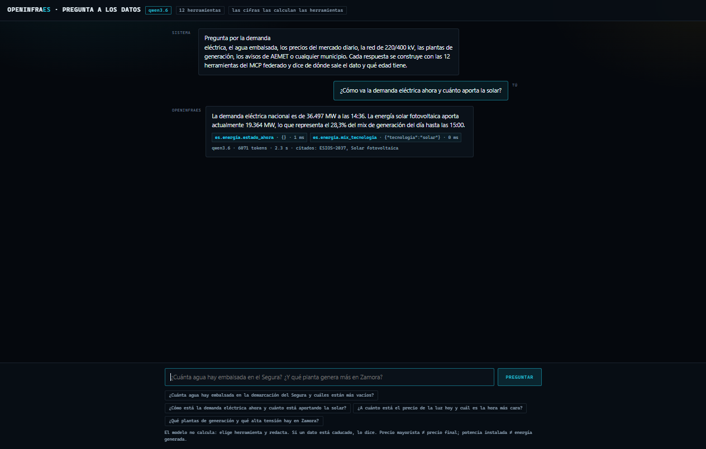

# Un MCP federado sobre todas las fuentes

Estudio medido de **CivicMesh OS · Madrid Live** (`https://d2xka41wp2rujl.cloudfront.net/`, demo de
centro de mando municipal sobre CloudFront) y diseño de lo mismo para OpenInfraES: **que las 77 capas
del repositorio hablen por una sola superficie MCP**, con un solo vocabulario y un solo contrato de
respuesta.

No es un resumen de la portada: todo lo que sigue sale de hablarle al servidor.

## 1. Qué se ha medido (y con qué resultado)

| Sonda | Resultado real |
|---|---|
| `GET /` | 910 bytes de HTML. SPA de Vite, sin SSR: todo el estado llega por API |
| `GET /api/state` | **200 · 4.108.367 bytes** de JSON con **24 claves**: salud, KPIs, telemetría, catálogo de fuentes, GeoJSON de distritos y tráfico, sensores, incidencias, aire, OAC, GTFS, agentes, topología, trazas MCP, alertas, propuestas HITL, simulador |
| `POST /api/mcp` `tools/list` | **9 herramientas** con `inputSchema`, `ownerAgentId` y `defaultSampleArgs` |
| `POST /api/mcp` `initialize` | **`-32601 Method not found`** — no implementa el handshake MCP |
| `POST /api/mcp` `tools/call` | Contrato propio: `content[]` + `structuredData` + `meta` |
| `POST /api/assistant/ask` | LLM real (ICA · IBM, `claude-advantage-assist`), devuelve `toolsInvoked` y `citedEntityIds` |
| `feeds[]` | **6 fuentes** con `crsOriginal` → `crsNormalized`, `sourceStatus`, `latencyMs`, `refreshIntervalSec` y `fallbackSnapshotPath` |
| `tunnelsSigma` | **11 servicios ArcGIS** consultados → 40 túneles y 4.189 equipos (BIE, columnas secas, galibos, paneles VMS…) |
| `ontology.traverse_impact` | OWL 2 / NGSI-LD / SHACL: 11 tripletas locales, **137 tripletas remotas**, 118 entidades validadas con 0 violaciones |

### El hallazgo incómodo, y el más útil

El estado que devuelve **ahora mismo** está en **modo simulación**: `simulator.isSimulationActive:
true` con el preset *DANA M-30 Sur*, y cada entidad afectada lo declara en su propio campo
(`isSimulated: true`, `isSimulatedOverride: true`). Un panel de mando que enseña una crisis simulada
como si fuera Madrid en vivo es exactamente el fallo que ya nos costó cuatro días de «35.028 MW · ahora»
en OpenInfraES. **Lo bueno de este diseño es dónde va el aviso: en el dato, no en la leyenda.** Eso sí
se copia.

## 2. La arquitectura que hace que «todas las fuentes sean un MCP»

```
  6 fuentes oficiales                estado canónico                superficies
┌──────────────────────┐        ┌────────────────────┐        ┌──────────────────┐
│ Informo pm.xml       │        │                    │        │ GET /api/state   │ → panel
│ Informo incid.xml    │──────▶ │  servicio ingest   │──────▶ │ POST /api/mcp    │ → agentes
│ calair_tiemporeal    │        │  (normaliza CRS,   │        │ POST /assistant  │ → LLM encima
│ SIGMA distritos      │        │   cachea, sella)   │        └──────────────────┘
│ CRTM/EMT GTFS        │        │                    │
│ OAC 010 Línea Madrid │        └────────────────────┘
└──────────────────────┘                 │
                          cada entidad lleva fuente, hora y si es simulada
```

La regla que lo hace funcionar, y que es la lección entera:

> **El MCP no habla con las fuentes. Habla con el estado.**
> Las fuentes se normalizan una vez; el vocabulario (las herramientas) se diseña una vez; y cualquiera
> de las dos puntas —un panel o un agente— consume lo mismo.

Comprobación en el propio dato: las 40 trazas MCP recientes citan **5 capas distintas** y todas las
respuestas traen `dataSourceIds` y `citedIds`. La trazabilidad no es un documento, es un campo.

## 3. Los nueve patrones que se copian

1. **Una herramienta por pregunta, no por fuente.** No hay `get_pm_xml`. Hay
   `madrid.traffic.query_sensors(districtId, minCarga, roadQuery)`. El agente no sabe qué fichero tiene
   el dato; sabe qué pregunta quiere responder.
2. **Namespace de dominio en el nombre.** `madrid.<dominio>.<verbo_objeto>`: el prefijo agrupa, el verbo
   dice qué hace. `madrid.air.evaluate_no2_protocol` se elige solo por su descripción.
3. **Un catálogo de fuentes como dato, no como documentación.** `feeds[]` declara por fuente el CRS de
   origen y el normalizado, la latencia, la frecuencia y el snapshot de respaldo. Sin eso no se puede
   contar de dónde salió un número.
4. **Contrato de respuesta con tres capas.** `content[]` (texto que lee el modelo), `structuredData`
   (el objeto que consume una app) y `meta` (fuente, hora, latencia, ids citados). La misma respuesta
   sirve a un agente y a un panel.
5. **El análisis va dentro.** `madrid.geo.district_digest` devuelve, por distrito, salud, estrés, riesgo,
   carga media, congestión, incidencias por categoría, NO₂, rutas, espera del 010 y etiquetas de crisis.
   No devuelve 3.603 sensores para que el modelo los sume.
6. **Grafo para preguntas de propagación.** «Si el túnel X se inunda, ¿qué se ve afectado?» no se
   responde con un `WHERE distrito = X`: se recorre el grafo. La utilidad está en los predicados
   causales (`spillsOverToSurface`, `impactsTransitRoute`, `triggersProtocoloNO2`), no en el formato RDF.
7. **Trazas visibles.** `recentMcpTraces` guarda la petición y la respuesta JSON-RPC completas: se puede
   auditar qué herramienta se llamó con qué argumentos y qué se devolvió.
8. **Un `/api/state` para la web.** El panel no hace 30 llamadas: pide un agregado. Las herramientas son
   para preguntas; el estado es para pintar.
9. **El LLM va encima, nunca dentro del camino crítico.** El asistente es una capa opcional que elige
   herramientas (`toolsInvoked`) y cita entidades; el dato ya está calculado antes de que él llegue.

## 4. Lo que NO se copia

- **`initialize` sin implementar.** Un cliente MCP de verdad (Claude Code, Cursor, VS Code) falla el
  handshake y no ve ninguna herramienta. Lo que hay ahí es *JSON-RPC con forma de MCP*: sirve para su
  propia web, no para conectarse a un agente. Nuestro servidor cumple el protocolo completo.
- **El teatro operativo: simulador, presets de crisis, caos, HITL, Kafka.** Tiene sentido en un centro de
  mando municipal que enseña cómo respondería la ciudad. En OpenInfraES no hay decisiones que firmar ni
  agentes que coordinar: añadirlo sería escenografía y 4 MB de estado por visita.
- **Ontología inventada para lucir.** 137 tripletas generadas y 7 shapes SHACL para validar 118
  entidades es trabajo real, pero el valor está en los predicados causales, no en el OWL. Nuestra
  ontología útil es la que ya existe y es comprobable: **capa → organismo → municipio → distrito**.
- **El LLM como cerebro.** 4,8 s y 0,009 $ por pregunta para responder lo que ya está en el
  `structuredData`. Como traductor de lenguaje natural a herramienta, sí; como calculadora, no.

## 5. OpenInfraES ya tiene el 80 % de la infraestructura

| CivicMesh lo llama | OpenInfraES ya lo tiene |
|---|---|
| `feeds[]` con estado y caducidad | **`datos/catalogo.json`**: 77 capas con organismo, jerarquía, licencia en 3 estados, TTL, `edad_dias` y `caducado` |
| `crsOriginal` → `crsNormalized` | Todo el repo está en EPSG:4326, declarado por capa |
| `fallbackSnapshotPath` | `datos/` versionado en git: el snapshot es el repo entero |
| Servicio `ingest` | Los capturadores + el cron de refresco de GitHub Actions |
| Health checks | `catalogo.py` (avisos), `validar.py` (VERDE o no se publica), `_recibo.json` por capa |
| `district_digest` | `es.geo.municipio` (publicado hoy, ver abajo) |
| TTL por fuente | `ttl_segundos` por capa, ya calculado |

Lo que faltaba era exactamente una cosa: **la superficie**. 77 capas de datos sin una sola puerta que un
agente pueda abrir. Eso es lo que se ha construido.

## 6. El contrato de respuesta

```json
{"jsonrpc":"2.0","id":9,"result":{
  "content": [{"type":"text","text":"Soria (Soria, INE 42173): 41.025 hab. en 271,86 km² …"}],
  "structuredData": {"municipio": {...}, "energia": {...}, "agua": {...}},
  "isError": false,
  "meta": {
    "toolName":"es.geo.municipio",
    "executedAt":"2026-11-23T16:07:10+00:00",
    "latencyMs":292,
    "dataSourceIds":["municipios","plantas","embalses","red-electrica","edar","etap"],
    "citedIds":["42173"],
    "frescura":[{"capa":"embalses","organismo":"MITECO","fecha_dato":"2026-11-10","edad_dias":13,
                 "ttl_dias":7.0,"caducado":true,"licencia":"Reutilización Ley 37/2007 con atribución"}],
    "aviso":["embalses: dato de 2026-11-10 (13 días, TTL 7.0) — CADUCADO"]
  }}}
```

Cinco reglas, todas nacidas de un error real:

1. **Cada respuesta dice fuente, fecha, resolución y edad.** Un dato viejo con etiqueta de presente es
   peor que un hueco.
2. **Si está caducado, se dice en el texto y en `meta.aviso`**, no en una nota al pie que nadie lee.
3. **El análisis se hace aquí**: porcentajes, agregados, distancias, factores de carga y umbrales
   normativos se calculan en el servidor.
4. **`citedIds` siempre**: qué estaciones, plantas, embalses o tramos sostienen la frase.
5. **Los errores son contenido accionable** (`isError: true` con el motivo y la salida), nunca un cuelgue.

## 7. Las 12 herramientas publicadas

| Herramienta | Pregunta que responde | Fuentes | Análisis dentro |
|---|---|---|---|
| `es.datos.catalogo` | «¿qué tienes y de quién es?» | catalogo.json | licencia, TTL, caducidad |
| `es.datos.salud` | «¿qué puedo citar hoy?» | catalogo + vivos | caducadas, sin licencia, edad de cada vivo |
| `es.energia.estado_ahora` | «¿cómo va el sistema eléctrico?» | ESIOS + ENTSO-E | demanda, CO₂, bombeo, intercambios netos, mix completo |
| `es.energia.mix_tecnologia` | «¿cuánto ha producido cada tecnología?» | ENTSO-E A75 | MWh, %, MW medio, factor de carga, cuartos |
| `es.energia.precio_cuarto_hora` | «¿a cuánto está la luz y cuándo es caro?» | OMIE | media, mín/máx con hora, 4 cuartos por hora |
| `es.agua.embalses` | «¿cómo está el agua?» | MITECO | % nacional y por demarcación, más vacíos/llenos |
| `es.red.cerca` | «¿qué alta tensión tengo al lado?» | OSM/IGN | distancia punto-polilínea, longitud, tensiones |
| `es.red.resumen_punto` | «¿qué hay en 30 km a la redonda?» | plantas, red, agua, gas | potencia por tecnología, EDAR/ETAP, desaladoras, gasoductos |
| `es.plantas.buscar` | «¿cuánta nuclear hay y dónde?» | REE + ELECTRA | agregados por tecnología, provincia, CCAA |
| `es.clima.avisos` | «¿qué avisos meteorológicos hay?» | AEMET/Meteoalarm | vigentes por nivel y fenómeno |
| `es.transporte.vivo` | «¿dónde están los trenes?» | GTFS-RT Renfe | por línea, última posición, aviso de licencia |
| `es.geo.municipio` | «¿qué tiene este municipio?» | INE + 5 capas | point-in-polygon: plantas, MW, embalses, EDAR, ETAP, alta tensión |

**Roadmap inmediato** (cada una es una pregunta, no un fichero): `es.gas.gasoductos_cerca`,
`es.carburantes.precio_municipio`, `es.carreteras.incidencias`, `es.sismos.recientes`,
`es.transporte.estaciones_cerca`, `es.aeropuertos.cerca`, `es.hidrogeno.corredores`,
`es.datos.ficha_capa` (abrir la ficha de una capa concreta con su procedencia completa).

## 8. Cómo se enciende

```bash
python scripts/mcp_openinfra.py                 # stdio NDJSON — Claude Code, Cursor, VS Code
python scripts/mcp_openinfra.py --http 8077     # POST /api/mcp + GET /api/state — web y remoto
python scripts/mcp_openinfra.py --test          # autochequeo: 12 herramientas, framing y contenido
python scripts/mcp_openinfra.py --list-tools    # el catálogo en una pantalla
python scripts/chat_web.py                      # chat con Qwen 3.6 sobre las mismas herramientas
```

Registro en un cliente MCP:

```bash
claude mcp add openinfra -- python C:/Users/d_ant/Projects/OpenInfraES/scripts/mcp_openinfra.py
```

```json
{"mcpServers": {"openinfra": {
  "command": "python",
  "args": ["C:/Users/d_ant/Projects/OpenInfraES/scripts/mcp_openinfra.py"]}}}
```

## 9. Límites declarados (para no prometer de más)

- **No hay tensión en vivo por nudo**, ni producción medida por planta, ni tráfico en tiempo real: no
  existen en abierto. `es.plantas.buscar` devuelve potencia instalada; decirlo es parte del contrato.
- **28 de las 77 capas están caducadas** hoy. El servidor las sirve y las marca. No se esconde.
- **5 capas tienen la licencia sin cerrar** (`plantas`, `gtfsrt`, `red-electrica`…): el catálogo las
  señala y `es.datos.salud` las lista. Un MCP público no debe exponer lo que no se puede reutilizar.
- **Point-in-polygon sin agujeros y líneas por vértices**: es una aproximación declarada, no un catastro.
- **Todo stdlib.** Sin shapely, sin `mcp` SDK, sin dependencias: el protocolo cabe en un fichero y se
  instala donde haga falta.

## 10. Verificación (ejecutada el 2026-11-23)

```
$ python scripts/mcp_openinfra.py --test
initialize ok · tools/list 12 herramientas
ok es.datos.catalogo        77 capas, 63 de organismo productor, 5 sin licencia
ok es.datos.salud           28 caducadas · 7/7 conjuntos vivos legibles
ok es.energia.estado_ahora  36.474 MW · CO₂ 0,03 t/MWh · edad 0 min
ok es.energia.mix_tecnologia  49 cuartos · 359.790 MWh · nuclear 20,75 %
ok es.energia.precio_cuarto_hora  OMIE PT15M · 96 cuartos
ok es.agua.embalses         397 embalses · 31.261 de 56.424 hm³
ok es.red.cerca             252 tramos en 20 km de Madrid (202 de 220 kV, 50 de 400 kV)
ok es.red.resumen_punto     136 plantas · 3.354 MW en 40 km de Zaragoza
ok es.plantas.buscar        5 nucleares · 7.117 MW
ok es.clima.avisos          177 vigentes (155 amarillo, 22 naranja)
ok es.transporte.vivo       35 vehículos Renfe
ok es.geo.municipio         Zamora: 59.815 hab · 1 planta · 282 ms
VERDE: 12 herramientas, framing correcto, contenido verificado
```

Y por HTTP: `GET /api/state` responde en 14 ms con KPIs, mix, precio y agua; `POST /api/mcp` acepta
`tools/list` y `tools/call`; `GET /salud` da el estado del proceso.

## 11. Un chat encima: Qwen 3.6 (NaN) hablando con los datos

La misma superficie tiene un tercer consumidor: una persona preguntando en lenguaje natural.

```
navegador  ──POST /chat──▶  chat_web.py  ──tools──▶  qwen3.6 (NaN)  ──▶ elige herramienta
   ▲                             │                                        │
   └────── respuesta + traza ────┴────────── ejecuta el MCP en proceso ◀──┘
```



`scripts/chat_web.py` (stdlib, sin dependencias):

```bash
python scripts/chat_web.py                 # http://127.0.0.1:8080
python scripts/chat_web.py --probar        # 3 preguntas end-to-end, sin navegador
```

**La clave del modelo no sale nunca al navegador.** El proceso hace de proxy: el navegador solo
habla con `/chat`, y el servidor pone la `Authorization`. Es la razón por la que esto no puede ser
JavaScript en GitHub Pages: publicar la clave es regalarla.

### Lo que se midió de qwen3.6 (NaN, vía gateway LiteLLM)

| Prueba | Resultado |
|---|---|
| ¿Hace tool-calling? | **Sí**, y en paralelo (2 herramientas en la misma respuesta) |
| Latencia eligiendo herramienta | **707 ms** con `reasoning_effort: "low"` |
| Sin ese freno | **1.537 tokens de razonamiento**, `finish_reason="length"` y `content` **vacío** |
| Respuesta completa (1 herramienta) | 2,3 s · ~5.400 tokens de prompt (las 12 herramientas pesan) |
| Respuesta con 2-3 herramientas | 2,5-11 s según el número de saltos |

Trampa pagada: qwen3.6 es un modelo **pensante**. Con `max_tokens` corto gasta el presupuesto en el
razonamiento y devuelve vacío sin llamar a ninguna herramienta — y eso no es un error del MCP ni de
los datos. Tres defensas, todas en el código:

1. `reasoning_effort: "low"` en cada llamada;
2. si la primera respuesta llega vacía y sin herramienta, **reintento con `tool_choice: "required"`**;
3. si aun así no hay texto, se devuelve el texto de la herramienta marcado como tal: un hueco
   declarado vale más que una frase inventada.

### Qué hace y qué no hace el modelo

- **Elige** entre las 12 herramientas y sus argumentos.
- **Redacta** con el `structuredData` que ya viene calculado.
- **Repite** los avisos de caducidad (regla del *system prompt*).
- **No calcula**: ni porcentajes, ni agregados, ni distancias. Eso está hecho antes de que él llegue.

### Llevarlo a la web pública

| Vía | Qué hace falta | Coste |
|---|---|---|
| **A. El proceso en la VM NaN + túnel** | `chat_web.py` corriendo 24/7 y un `cloudflared tunnel` al puerto | gratis (el túnel) + la VM que ya tienes |
| **B. Worker de Cloudflare + MCP por túnel** | el Worker guarda la clave, hace el bucle de herramientas contra `POST /api/mcp` | gratis en el plan free |
| **C. Clave en el navegador** | nada | **no se hace** |

En A, el propio `chat_web.py` sirve la página: cero infraestructura extra. En B hace falta exponer el
MCP y traducir los esquemas a JS, a cambio de aguantar más visitas sin la VM. Las dos respetan la
regla: la clave vive en el servidor, y el chat es un consumidor más del mismo vocabulario.

## Fuentes de este documento

- CivicMesh OS · Madrid Live — `https://d2xka41wp2rujl.cloudfront.net/api/state`,
  `/api/mcp`, `/api/assistant/ask` (sondados el 2026-11-23).
- Datos servidos por OpenInfraES: `datos/catalogo.json` (77 capas) y las capas citadas en cada
  herramienta; los organismos productores aparecen en la tabla del apartado 7.
- Patrón de organismo → MCP: [`PATRON-MCP.md`](PATRON-MCP.md).
